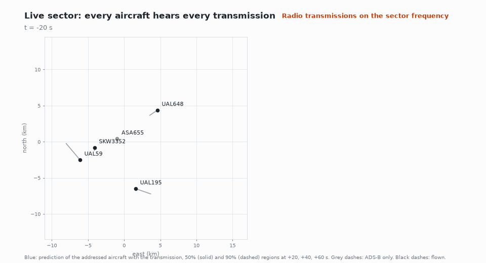

# Aircraft Trajectory Prediction from ADS-B and Imperfect ATC Transcripts

Predicting where an aircraft will be over the next minute, from its ADS-B track and a controller instruction known only through an imperfect speech transcript.


*Synthetic test transmissions (simulated recognizer) on recorded ADS-B tracks. Words are shaded by recognizer confidence. Blue: the composed prediction, 12 sampled instructions × 6 trajectories. Gray: ADS-B only. Dashed: what the aircraft flew.*



*Several aircraft on one frequency. Each transmission is heard by every aircraft; the model identifies the recipient across them and predicts the recipient's next 60 s, shown as the 50 % and 90 % regions at +20, +40 and +60 s, as in the [interactive demo](demo/README.md).*

## Why

Conflict detection, arrival sequencing and separation all rest on predicting each aircraft's near-term trajectory. Over a minute or two, that trajectory is driven by controller instructions such as *turn left heading 270* or *descend and maintain 5,000*. An instruction is the strongest single cue to what an aircraft is about to do, often well before the change shows up on surveillance.

Instructions reach a ground system only as voice. Automatic speech recognition (ASR) confuses digits, drops words, swaps *climb* and *descend*, and often loses the callsign that says who the transmission is for. A predictor that takes the transcript at face value inherits those errors without knowing it.

This project keeps track of how uncertain the instruction is, and of who it is for, and carries that uncertainty into the predicted trajectories.

## The approach (v2)

```
p(Y | O, X)  ≈  Σ_Z  q_φ(Z | O, X) · p_θ(Y | X, Z)
```

| | |
|---|---|
| `O` | the transcript, one recognizer confidence per word |
| `X` | the aircraft's last 30 s of ADS-B at 1 Hz, its type and its callsign |
| `Z` | the structured instruction representation: whether the transmission addresses this aircraft, and its lateral, vertical and speed instruction |
| `Y` | the next 60 s of flight |

```
transcript O ─► semantic belief model (SBM) ─► K = 12 sampled instruction representations Z_k
history X  ─┬──────────────────────────────┘
            └► conditional trajectory predictor (CTP) ─► S = 6 trajectories per Z_k ─► 72 trajectories
```

- The **semantic belief model** gives a probability distribution over structured instruction representations, not just a best guess, so a misheard *five* or a clipped callsign stays visible as uncertainty. It compares the callsign it hears with the aircraft's own ADS-B callsign.
- The **conditional trajectory predictor** is a flow-matching model on 18 trajectory-shape coefficients (a PCA basis of the training futures). It gives the spread that remains once the instruction is known: pilot delay, rates, wind and performance.
- **Composition** samples several instruction representations from the belief and several trajectories under each. With several aircraft on a frequency, recipient identification across the aircraft uses the fact that a transmission addresses at most one of them.

### Synthetic test set

Recorded ADS-B, transcripts simulated from a recognizer channel fitted to real ATC speech. Horizontal energy score over 60 s in metres (lower is better) on 5,000 held-out segments; means over three training runs, ± standard deviation:

| | own-aircraft maneuver instructions | all transmissions | 90 % coverage |
|---|---|---|---|
| ADS-B only (ignores the radio) | 3,202 | 2,988 | 0.85 |
| CTP conditioned on the transcript directly (no SBM) | 2,187 | 2,751 | 0.85 |
| SBM most probable instruction → CTP | 1,727 ± 2 | 2,732 | 0.84 |
| **SBM, 12 sampled instructions × 6 trajectories → CTP** | **1,682 ± 5** | **2,701** | 0.86 |
| CTP given the semantic label (reference, not available in operation) | 1,556 ± 2 | 2,615 | 0.85 |

The composed prediction keeps 92 % of the improvement that the semantic label itself would give over ADS-B only. Its advantage over the most probable instruction is concentrated on the transmissions whose most probable instruction is wrong. On transmissions that carry no motion instruction for the aircraft, ADS-B only remains better.

### Recorded controller speech

4,863 controller transmissions recorded at San Francisco (KSFO) and Boston (KBOS) on two days in July 2026, transcribed by two ATC-fine-tuned Whisper large-v3 recognizers and matched to the ADS-B of the aircraft named in them. No model was trained, tuned or selected on these data, and Boston lies outside the region the trajectory models were trained on. The recordings have no human labels, so the score is measured against the trajectory each aircraft then flew. Horizontal energy score in metres; means over three training runs:

| | all controller transmissions | heading, altitude and speed instructions | Boston (new airport) |
|---|---|---|---|
| ADS-B only | 4,400 | 5,064 | 5,088 |
| SBM most probable instruction → CTP | 3,649 ± 15 | 3,582 ± 37 | 3,858 ± 65 |
| **SBM, 12 × 6 → CTP** | **3,452 ± 46** | **3,360 ± 26** | **3,661 ± 85** |

Composition improves on ADS-B only by 22 % overall, by 34 % on heading, altitude and speed instructions, and by 23 % on the 1,352 transmissions whose audio the recognizers never saw in training. It ranks the addressed aircraft first in 93 % of transmissions. The limits are as clear: tower transmissions, which carry takeoff and landing clearances outside the representation, are worse than ADS-B only (3,146 against 2,841 m); the vertical score is slightly worse (1,050 against 1,006 ft); and the prediction is overconfident (over all 9,010 matched transmissions, nominal 90 % intervals cover 0.81 of flown positions). The evaluation set belongs to a research collaboration and is not released; only these aggregates are reported.

### Cost

One composed prediction (one transmission, one aircraft, 72 trajectories) takes about 0.18 s on a laptop CPU (Apple M4 Pro, four threads), more than 90 % of it in the flow integration.

### Interactive demo

The [`demo/`](demo/README.md) folder serves the models behind a small web interface that runs on your own machine:

- **Live sector:** a few held-out flights on one day, synthetic transmissions arriving on the shared frequency, the recipient identified across the aircraft, a replay clock, and transmissions you type yourself (the second animation above).
- **Try a transmission:** edit a transcript word by word, lower a word's recognizer confidence, and compare the composed prediction with the most probable instruction, the semantic label, ADS-B only, the transcript-conditioned flow and a kinematic rule.
- **Compare models:** two semantic belief models, trajectory predictors or samplers side by side on one scale.

Each view can show the sampled trajectories, the 50 % and 90 % regions where the aircraft is predicted to be at +20, +40 and +60 s, or both. To run it after cloning (CPU is enough; about 0.2 s per prediction):

```bash
uv sync --extra demo                                           # in a fresh clone; otherwise --all-extras
gh auth login                                                  # once
uv run python scripts/artifacts.py fetch --models-only --demo  # main models + the demo's extra models and data (~80 MB)
uv run uvicorn demo.server.app:app --port 7860                 # then open http://localhost:7860
```

The demo data are held-out windows with airline callsigns, positions relative to the aircraft or to the scene centre, and synthetic transmissions; no raw ADS-B and no recorded speech. Only the variants whose checkpoints are installed appear in the menus.

## Install

Managed with [uv](https://docs.astral.sh/uv/); `uv.lock` pins every dependency. Python 3.11+.

```bash
uv sync --all-extras          # .venv from the lock
uv run pytest                 # 69 tests in seconds; the 3 demo tests need the demo bundle
```

PyTorch picks CUDA, then Apple MPS, then CPU; override with `--device`.

## Get the trained models

The weights are release assets, not in git. The processed dataset is derived from OpenSky data, so it is shared only through a gated Hugging Face dataset: request access on its page first.

```bash
gh auth login                                          # once
uv run python scripts/artifacts.py fetch --models-only # the main model and its baselines (~38 MB)
hf auth login                                          # once, after access is granted
uv run python scripts/artifacts.py fetch --hub alexzongo   # the models and the processed v2 dataset (~2 GB)
```

The models are also on the Hub (`fetch --hub alexzongo --models-only`).

| checkpoint | what it is |
|---|---|
| `runs/v2/sbm_jacktol_ho_s0.pt` | final semantic belief model: callsign contrast and handoff phrases (vocabulary included) |
| `runs/v2/ctp_basis_atoms_zfix_s0.pt` | conditional trajectory predictor (basis included) |
| `runs/v2/ctp_basis_none_s0.pt` | ADS-B-only predictor: the "radio tells us nothing" answer |
| `runs/v2/anchors_atoms_zfix_s0.pt` | mixture-density alternative to the flow: similar accuracy on maneuver instructions, coverage closer to nominal, one network call |
| `runs/v2/ctp_basis_text_s0.pt` | baseline: trajectory predictor conditioned on the transcript directly, without the SBM |

Downloads are checked against `SHA256SUMS`. Without the GitHub CLI, download the assets from the `data-v2` release page and run `fetch --from <folder>`.

## Run it on your data

Real transcripts plus ADS-B, from OpenSky or adsb.lol:

```python
from atc_forecast.inference import Forecaster, load_states

fc = Forecaster.load("runs/v2/sbm_jacktol_ho_s0.pt", "runs/v2/ctp_basis_atoms_zfix_s0.pt")
states = load_states("adsb/*.parquet")                 # or adsb.lol traces: source="readsb"
out = fc.forecast(states, icao24="a1b2c3", t0=1767225612.4,
                  words=[{"word": "united", "probability": 0.98}, ...])   # faster-whisper words
out["readings"]                       # most probable instruction representations: [("own_motion | L270 | descend 5,000 | -", 0.81, atoms), ...]
out["lat"], out["lon"], out["alt_ft"] # 72 future trajectories x 60 s
```

To evaluate a set of matched transmissions against what the aircraft then flew:

```bash
uv run python -m atc_forecast.evaluation.real_v2 \
    --transmissions transmissions.jsonl --adsb "adsb/*.parquet" \
    --sbm runs/v2/sbm_jacktol_ho_s0.pt --ctp runs/v2/ctp_basis_atoms_zfix_s0.pt \
    --hist-only runs/v2/ctp_basis_none_s0.pt --scene-radius-nm 40 \
    --out results/real.json --per-message results/real_messages.jsonl
```

The input format, what a matched set does and does not measure, and the checks behind it are in [docs/v2/real-data.md](docs/v2/real-data.md). One of those checks: on test transmissions rebuilt from raw ADS-B, the real-data path reproduces the training inputs bit for bit, and reproduces the test evaluation's scores exactly.

## Documentation

| | |
|---|---|
| [docs/v2/real-data.md](docs/v2/real-data.md) | running and evaluating on real transcripts and ADS-B |
| [docs/v2/results.md](docs/v2/results.md) | results, ablations, calibration, where the error remains, open directions |
| [docs/v2/pipeline.md](docs/v2/pipeline.md) | rebuilding everything: data, transmissions, training, W&B, evaluation, diagnosis, hyperparameters, code map |
| [docs/v1.md](docs/v1.md) | the v1 two-stage model |

## Repository layout

```
src/atc_forecast/
  inference/    real data: ADS-B readers (OpenSky, readsb/adsb.lol), transcripts, Forecaster
  data/         ADS-B to 1 Hz windows (resample, frames, Kalman), atoms, messages
  channel/      the simulated recognizer and its word confidence
  models/       sbm.py, ctp.py, baselines.py (MDN, anchors, kinematic rule), prim.py
  training/     sbm_v2.py, traj_v2.py, batches, W&B
  evaluation/   compose_v2.py (test set), addressee_v2.py (frequencies), real_v2.py, metrics_v2.py
  collect/      OpenSky download, aircraft type database
  asr/          transcription of real audio (faster-whisper)
  app/          the v1 viewer
demo/           web demo: model service (FastAPI), front end, bundle builder, Space packaging
scripts/        run_v2.sh (the whole plan), artifacts.py (releases), diagnosis and inspection
tests/
```

v1 modules (`models/stage1.py`, `models/stage2.py`, `data/windows.py`, `evaluation/compose.py`) sit alongside v2 and are untouched.

## Data handling

- Raw OpenSky ADS-B is never redistributed: OpenSky's terms restrict it. The processed 1 Hz windows are shared only through the gated Hugging Face dataset, and GitHub releases carry the model weights only.
- Recorded controller speech (LiveATC) is used for evaluation only. The July 2026 KSFO and KBOS evaluation set belongs to a research collaboration and is not released; neither audio nor transcripts are shipped, and results are reported as aggregates.
- The recognizer channel is fitted on ATCO2 and ATCOSIM benchmark transcripts. The recordings, their labels and the fitted word-confidence file are for internal research use and are not shipped; without them the transmission builder uses a parametric word-confidence fallback of the same shape.

## Citation

A paper describing this work, with the same title, is in preparation. Until it is published, please cite the software (GitHub's **Cite this repository** button gives the same entry from `CITATION.cff`):

```bibtex
@software{zongo2026atc,
  author  = {Zongo, Alex and Petit, Mathurin and Brusset, Louis and Kam, Jordan and
             Torun, Emir and Ghazanfari, Mahyar and Wei, Peng and McNaughton, Nathan and
             Bayen, Alexandre},
  title   = {Aircraft Trajectory Prediction from {ADS-B} and Imperfect {ATC} Transcripts},
  year    = {2026},
  version = {0.1.0},
  note    = {Software; paper in preparation}
}
```

If you use the ADS-B data, please also cite the OpenSky Network:

```bibtex
@inproceedings{schafer2014opensky,
  author    = {Sch{\"a}fer, Matthias and Strohmeier, Martin and Lenders, Vincent and
               Martinovic, Ivan and Wilhelm, Matthias},
  title     = {Bringing Up {OpenSky}: A Large-scale {ADS-B} Sensor Network for Research},
  booktitle = {Proceedings of the 13th International Symposium on Information
               Processing in Sensor Networks (IPSN)},
  year      = {2014},
  pages     = {83--94}
}
```

## Acknowledgements

This project was inspired by [Louis Brusset](https://github.com/LouisBrusset) and [Mathurin Petit](https://github.com/matu1003)'s earlier work. Aircraft surveillance data comes from the [OpenSky Network](https://opensky-network.org); the simulated recognizer is fitted on the [ATCO2](https://www.atco2.org) corpus.

## License

MIT; see [`LICENSE`](LICENSE).
