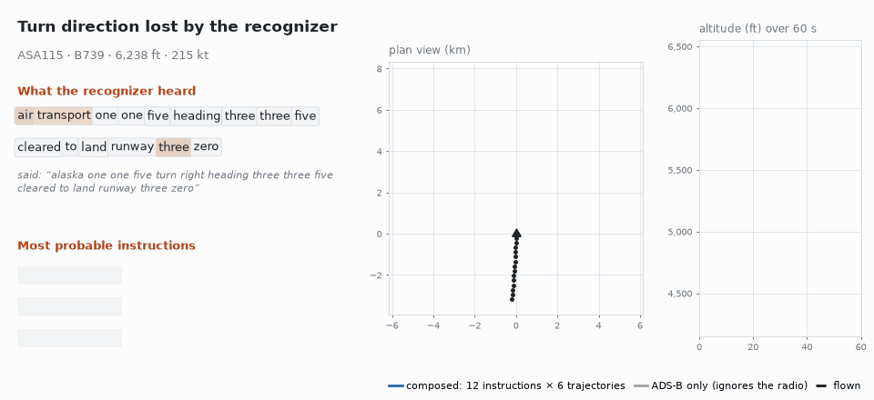

# Aircraft trajectory prediction under ATC instruction uncertainty

Predicting where an aircraft will be over the next minute, from its ADS-B track and a controller instruction known only through an imperfect speech transcript.



*Synthetic test transmissions (simulated recognizer) on real ADS-B tracks. Word chips are shaded by recognizer confidence. Blue: the prediction from 12 interpretations × 6 trajectories. Gray: history only. Dashed: what the aircraft flew.*

## Why

Conflict detection, arrival sequencing and separation all rest on predicting each aircraft's near-term trajectory. Over a minute or two, that trajectory is driven by controller instructions such as *turn left heading 270* or *descend and maintain 5,000*. An instruction is the strongest single cue to what an aircraft is about to do, often well before the change shows up on surveillance.

Instructions reach a ground system only as voice. Automatic speech recognition (ASR) confuses digits, drops words, swaps *climb* and *descend*, and often loses the callsign that says who the transmission is for. A predictor that takes the transcript at face value inherits those errors without knowing it.

This project keeps track of how uncertain the instruction is, and of who it is for, and carries that uncertainty into the predicted trajectories.

## The approach (v2)

```
p(Y | O, X)  ≈  Σ_Z  q_φ(Z | O, X) · p_θ(Y | X, Z)
```

| | |
|---|---|
| `O` | the transcript, one recognizer confidence per word |
| `X` | the aircraft's last 30 s of ADS-B at 1 Hz, and its type |
| `Z` | the interpretation of the transmission: is it for this aircraft, and what lateral, vertical and speed change it asks for |
| `Y` | the next 60 s of flight |

```
transcript O ─► semantic belief model (SBM) ─► K = 12 interpretations Z_k, with probabilities
history X  ─┬──────────────────────────────┘
            └► conditional trajectory predictor (CTP) ─► S = 6 trajectories per Z_k ─► 72 trajectories
```

- The **semantic belief model** gives a distribution over interpretations. It is not just a best guess, so a misheard *five* or a clipped callsign stays visible as uncertainty. It compares the callsign it hears with the aircraft's own ADS-B callsign.
- The **conditional trajectory predictor** is a rectified flow on 18 trajectory-shape coefficients (a PCA basis of the training futures). It gives the spread that remains once the instruction is known: pilot delay, rates, wind and performance.
- **Composition** draws several interpretations and several future trajectories under each. On a frequency with several aircraft, joint addressee inference uses the fact that a transmission addresses at most one of them, so each aircraft's prediction takes only its share of the instruction.

On the synthetic test set (real ADS-B, transcripts simulated from a fitted recognizer channel), errors are energy scores in metres, lower is better. Means over three training runs:

| | own maneuver | all transmissions | 90 % coverage |
|---|---|---|---|
| history only (ignores the radio) | 3,202 | 2,988 | 0.85 |
| CTP conditioned on the transcript directly | 2,187 | 2,751 | 0.85 |
| SBM most probable interpretation → CTP | 1,727 ± 2 | 2,732 | 0.84 |
| **SBM, 12 interpretations × 6 trajectories → CTP (main)** | **1,682 ± 5** | **2,701** | 0.86 |
| CTP given the reference interpretation (upper reference) | 1,556 ± 2 | 2,615 | 0.85 |

On recorded speech: 338 controller transmissions from a public NorCal Departure feed, transcribed by a general-purpose Whisper large-v3 and matched to the ADS-B of the aircraft addressed. Energy scores in metres, means over three SBM training runs with the same CTP:

| | energy score | addressed aircraft ranked first (of ~12 within 40 nm) |
|---|---|---|
| history only (ignores the radio) | 5,397 | — |
| SBM most probable interpretation → CTP | 5,454 | — |
| **SBM, 12 interpretations × 6 trajectories → CTP (main)** | **4,906 ± 52** | **98 %** |

Composition improves on history only by 9 %, and on the most probable interpretation alone by 10 %. Two limits remain. The prediction is overconfident on recorded speech (30 % of flown trajectories fall in the outer tenth), and the vertical error is still worse than history only. The set is private (only aggregates are reported) and not fully independent of training, since part of the SBM's training phrasing was taken from the same frequency.

Ablations, the SBM versions, calibration, recorded speech and where the error remains are covered in [docs/v2/results.md](docs/v2/results.md).

v1, the original two-stage model behind the first results, is documented in [docs/v1.md](docs/v1.md) and tagged `v1.0.0`. Its code is unchanged.

## Install

Managed with [uv](https://docs.astral.sh/uv/); `uv.lock` pins every dependency. Python 3.11+.

```bash
uv sync --all-extras          # .venv from the lock
uv run pytest                 # 66 tests in seconds; no data, checkpoints or network
```

PyTorch picks CUDA, then Apple MPS, then CPU; override with `--device`.

## Get the trained models

The weights are release assets, not in git. The processed dataset is derived from OpenSky data, so it is shared only through a gated Hugging Face dataset: request access on its page first.

```bash
gh auth login                                          # once
uv run python scripts/artifacts.py fetch --models-only # the main model and its baselines (~38 MB)
hf auth login                                          # once, after access is granted
uv run python scripts/artifacts.py fetch --hub alexzongo   # the models and the processed v2 dataset (~2 GB)
```

The models are also on the Hub (`fetch --hub alexzongo --models-only`).

| checkpoint | what it is |
|---|---|
| `runs/v2/sbm_jacktol_ho_s0.pt` | final semantic belief model: callsign contrast and handoff phrases (vocabulary included) |
| `runs/v2/ctp_basis_atoms_zfix_s0.pt` | conditional trajectory predictor (basis included) |
| `runs/v2/ctp_basis_none_s0.pt` | history-only predictor: the "radio tells us nothing" answer |
| `runs/v2/anchors_atoms_zfix_s0.pt` | mixture-head alternative to the flow, better calibrated, single network call |
| `runs/v2/ctp_basis_text_s0.pt` | baseline: trajectory predictor conditioned on the transcript directly, without interpretations |

Downloads are checked against `SHA256SUMS`. Without the GitHub CLI, download the assets from the `data-v2` release page and run `fetch --from <folder>`.

## Run it on your data

Real transcripts plus ADS-B, from OpenSky or adsb.lol:

```python
from atc_forecast.inference import Forecaster, load_states

fc = Forecaster.load("runs/v2/sbm_jacktol_ho_s0.pt", "runs/v2/ctp_basis_atoms_zfix_s0.pt")
states = load_states("adsb/*.parquet")                 # or adsb.lol traces: source="readsb"
out = fc.forecast(states, icao24="a1b2c3", t0=1767225612.4,
                  words=[{"word": "united", "probability": 0.98}, ...])   # faster-whisper words
out["readings"]                       # [("own_motion | L270 | descend 5,000 | -", 0.81, atoms), ...]
out["lat"], out["lon"], out["alt_ft"] # 72 future trajectories x 60 s
```

To evaluate a set of matched transmissions against what the aircraft then flew:

```bash
uv run python -m atc_forecast.evaluation.real_v2 \
    --transmissions transmissions.jsonl --adsb "adsb/*.parquet" \
    --sbm runs/v2/sbm_jacktol_ho_s0.pt --ctp runs/v2/ctp_basis_atoms_zfix_s0.pt \
    --hist-only runs/v2/ctp_basis_none_s0.pt --scene-radius-nm 40 \
    --out results/real.json --per-message results/real_messages.jsonl
```

The input format, what a matched set does and does not measure, and the checks behind it are in [docs/v2/real-data.md](docs/v2/real-data.md). One of those checks: on test transmissions rebuilt from raw ADS-B, the real-data path reproduces the training inputs bit for bit, and reproduces the test evaluation's scores exactly.

## Documentation

| | |
|---|---|
| [docs/v2/real-data.md](docs/v2/real-data.md) | running and evaluating on real transcripts and ADS-B |
| [docs/v2/results.md](docs/v2/results.md) | results, ablations, calibration, where the error remains, open directions |
| [docs/v2/pipeline.md](docs/v2/pipeline.md) | rebuilding everything: data, transmissions, training, W&B, evaluation, diagnosis, hyperparameters, code map |
| [docs/v1.md](docs/v1.md) | the v1 two-stage model |

## Repository layout

```
src/atc_forecast/
  inference/    real data: ADS-B readers (OpenSky, readsb/adsb.lol), transcripts, Forecaster
  data/         ADS-B to 1 Hz windows (resample, frames, Kalman), atoms, messages
  channel/      the simulated recognizer and its word confidence
  models/       sbm.py, ctp.py, baselines.py (MDN, anchors, kinematic rule), prim.py
  training/     sbm_v2.py, traj_v2.py, batches, W&B
  evaluation/   compose_v2.py (test set), addressee_v2.py (frequencies), real_v2.py, metrics_v2.py
  collect/      OpenSky download, aircraft type database
  asr/          transcription of real audio (faster-whisper)
  app/          the v1 viewer
scripts/        run_v2.sh (the whole plan), artifacts.py (releases), diagnosis and inspection
tests/
```

v1 modules (`models/stage1.py`, `models/stage2.py`, `data/windows.py`, `evaluation/compose.py`) sit alongside v2 and are untouched.

## Data handling

- Raw OpenSky ADS-B is never redistributed: OpenSky's terms restrict it. The processed 1 Hz windows are shared only through the gated Hugging Face dataset, and GitHub releases carry the model weights only.
- Recorded controller speech (LiveATC) is used for evaluation only, under personal research use. Neither audio nor transcripts are shipped, and results are reported as aggregates.
- The recognizer channel is fitted on ATCO2 and ATCOSIM benchmark transcripts. The recordings, their labels and the fitted word-confidence file are for internal research use and are not shipped; without them the transmission builder uses a parametric word-confidence fallback of the same shape.

## Citation

A paper describing this work is in preparation. Until it is published, please cite the software (GitHub's **Cite this repository** button gives the same entry from `CITATION.cff`):

```bibtex
@software{zongo2026atc,
  author  = {Zongo, Alex and Petit, Mathurin and Brusset, Louis and Kam, Jordan and
             Torun, Emir and Ghazanfari, Mahyar and Wei, Peng and Bayen, Alexandre},
  title   = {Aircraft Trajectory Prediction under {ATC} Instruction Uncertainty},
  year    = {2026},
  version = {0.1.0},
  note    = {Software; paper in preparation}
}
```

If you use the ADS-B data, please also cite the OpenSky Network:

```bibtex
@inproceedings{schafer2014opensky,
  author    = {Sch{\"a}fer, Matthias and Strohmeier, Martin and Lenders, Vincent and
               Martinovic, Ivan and Wilhelm, Matthias},
  title     = {Bringing Up {OpenSky}: A Large-scale {ADS-B} Sensor Network for Research},
  booktitle = {Proceedings of the 13th International Symposium on Information
               Processing in Sensor Networks (IPSN)},
  year      = {2014},
  pages     = {83--94}
}
```

## Acknowledgements

This project was inspired by [Louis Brusset](https://github.com/LouisBrusset) and [Mathurin Petit](https://github.com/matu1003)'s earlier work. Aircraft surveillance data comes from the [OpenSky Network](https://opensky-network.org); the simulated recognizer is fitted on the [ATCO2](https://www.atco2.org) corpus.

## License

MIT; see [`LICENSE`](LICENSE).
